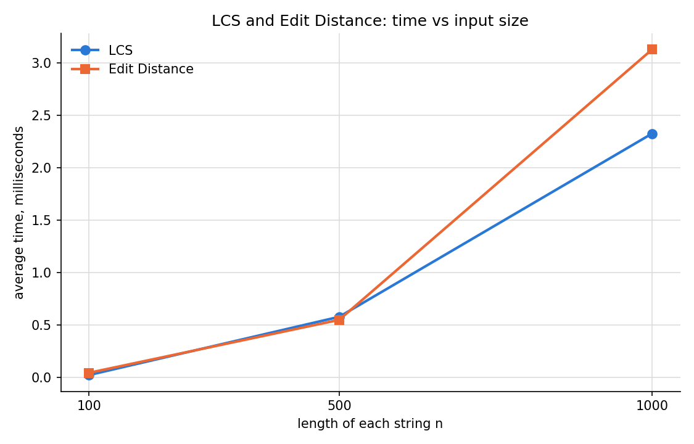
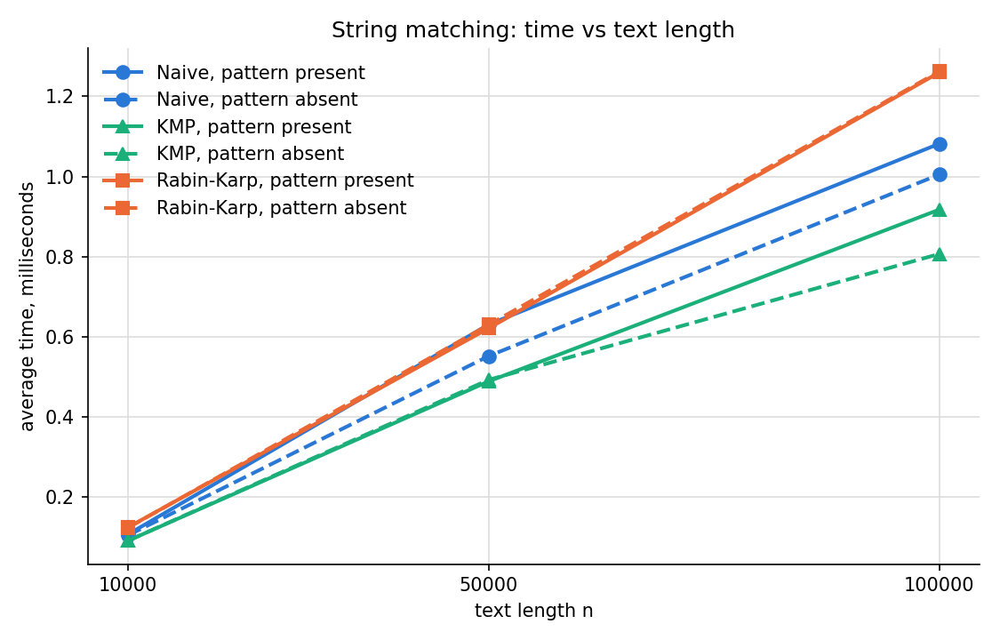

# Assignment 4: Text Analysis with Dynamic Programming and String Algorithms

Anarov Daniyal, SE-2530, Astana IT University.

Repository: https://github.com/Collector119/asik-aitu-daa4

## 1. Problem Description and Algorithm Overview

The application analyses text with three groups of algorithms:

| Part | Question | Algorithms |
|---|---|---|
| A. Dynamic programming | How similar are two strings? | Longest Common Subsequence (LCS), Edit Distance (Levenshtein) |
| B. String matching | Where does a pattern occur in a text? | Naive, Knuth–Morris–Pratt (KMP), Rabin–Karp |
| C. Advanced | How long is the common prefix of neighbouring sorted suffixes? | Kasai's LCP array |

**LCS** returns the length of the longest sequence of characters that appears in both
strings in the same order, not necessarily next to each other. For `ABCBDAB` and
`BDCABA` it is 4 (for example `BCBA`).

**Edit Distance** returns the minimum number of single-character insertions, deletions
and substitutions that turn one string into another. `kitten` → `sitting` needs 3:
two substitutions and one insertion.

**Naive matching** tries every start position in the text and compares the pattern
character by character. **KMP** first builds the LPS table of the pattern and then
scans the text without ever moving back. **Rabin–Karp** compares a hash of the pattern
with a rolling hash of every text window and checks characters only when the hashes
are equal. All three return the list of all start indices of the pattern.

**Kasai's algorithm** takes a string and its suffix array and builds the LCP array in
linear time.

```
src/
├── dp/             LongestCommonSubsequence, EditDistance
├── matching/       NaiveMatcher, KmpMatcher, RabinKarpMatcher
├── suffix/         SuffixArray, Kasai
├── Tests.java      correctness tests
└── Benchmark.java  experiments, writes results/tables/*.csv
results/
├── tables/         dp.csv, matching.csv, kasai.csv
└── plots/          dp_time_vs_length.png, matching_time_vs_text_length.png
```

Build and run (Java 17 or newer, no external libraries):

```
javac --release 17 -d out $(find src -name '*.java')
java -cp out Tests
java -cp out Benchmark
```

`Benchmark` must be run from the repository root, because it writes the tables to
`results/tables/`.

## 2. Implementation Decisions and Assumptions

Every algorithm is one class. **The constructor runs the algorithm**, and the result and
the operation counters are read with getters. So the benchmark times exactly one
constructor call, for example `new KmpMatcher(text, pattern)`.

**LCS.** `table[i][j]` is the LCS length of the first `i` characters of the first string
and the first `j` characters of the second one. Base cases: `table[i][0] = 0` and
`table[0][j] = 0`, because a string has nothing in common with an empty string.
Recurrence:

```
table[i][j] = table[i-1][j-1] + 1                     if first[i-1] == second[j-1]
table[i][j] = max(table[i-1][j], table[i][j-1])       otherwise
```

*Why it is correct.* Look at the last characters of both prefixes. If they are equal,
some LCS ends with this character: taking it can never hurt, because any common
subsequence that does not use it can be changed to use it instead of its own last
character. So the answer is one more than the LCS of both prefixes without it. If they
are different, they cannot both be the last character of a common subsequence, so at
least one of them is not used, and the answer is the better of the two cases "drop the
last character of the first string" and "drop the last character of the second string".
Every cell depends only on cells above and to the left, which are filled earlier, so
filling the table row by row is safe.

**Edit Distance.** `table[i][j]` is the distance between the first `i` characters of the
source and the first `j` characters of the target. Base cases: `table[i][0] = i` (delete
all `i` characters) and `table[0][j] = j` (insert all `j` characters). Recurrence:

```
table[i][j] = table[i-1][j-1]                                        if source[i-1] == target[j-1]
table[i][j] = 1 + min(table[i-1][j-1],   substitution
                      table[i-1][j],     deletion
                      table[i][j-1])     insertion                    otherwise
```

*Why it is correct.* In an optimal edit sequence, the last character of the source
prefix is either kept (only possible if it equals the last character of the target
prefix: no cost, solve the rest), substituted by the last target character (cost 1),
deleted (cost 1, the target prefix is unchanged), or the last target character is
inserted (cost 1, the source prefix is unchanged). These cases cover every possibility,
and each leaves a smaller subproblem that must itself be solved optimally, so the
minimum over them is the answer.

**Naive matching.** For every start `0 … n − m` the pattern is compared from the left
until the first mismatch.

**KMP.** `lps[i]` is the length of the longest proper prefix of `pattern[0..i]` that is
also a suffix of it. For `ababaca` it is `0 0 1 2 3 0 1`. During the search `matched`
is the number of pattern characters that match the text just before `textIndex`.

*How KMP avoids repeated comparisons.* When a mismatch happens after `matched`
characters, the last `matched` characters of the text are known: they are
`pattern[0..matched-1]`. The longest prefix of the pattern that can still be a match is
the longest prefix of `pattern[0..matched-1]` that is also its suffix, which is exactly
`lps[matched-1]`. So KMP sets `matched = lps[matched-1]` and continues from the **same**
text position. `textIndex` never decreases, and text characters already known to match
are never compared again. Every loop iteration makes one comparison and either advances
`textIndex` or shifts the pattern to the right, so there are at most 2n comparisons. The
LPS table is built the same way, with the pattern against itself, in at most 2m
comparisons. After a full match the search continues with `matched = lps[m-1]`, so
overlapping occurrences (`aba` in `abababa`) are found.

**Rabin–Karp.** The hash of a string `c₀c₁…c_{m-1}` is
`(c₀·B^{m-1} + c₁·B^{m-2} + … + c_{m-1}) mod Q` with `B = 256` and `Q = 1,000,000,007`
(a prime). Moving the window one step to the right removes the left character and adds a
new one in O(1):

```
hash = (hash - text[start] · B^{m-1}) · B + text[start + m]      (mod Q)
```

`B^{m-1} mod Q` is computed once before the search. All values stay below Q, so the
products fit in `long`.

*How Rabin–Karp handles collisions.* Different strings can have the same hash. So equal
hashes are only a candidate: the window is then compared with the pattern character by
character, and the index is added only if all characters match. A candidate that fails
this check is a **spurious hit** and is counted. Because Q is a large prime, two
different windows have the same hash with probability about 1/Q, so spurious hits are
very rare. No occurrence can be missed, because equal strings always have equal hashes.

**Kasai.** `lcp[i]` is the length of the longest common prefix of the suffixes that
start at `sa[i-1]` and `sa[i]`, the neighbours in sorted order; `lcp[0] = 0` because the
first suffix has no previous one.

*What the LCP array represents.* In sorted order, similar suffixes are neighbours, so
the LCP array shows how much each suffix shares with the closest suffix before it. For
example, the largest LCP value is the length of the longest substring that occurs at
least twice: in `banana` it is 3 (`ana`).

The algorithm goes through the suffixes in **text order** (position 0, 1, 2, …), not in
sorted order. `rank[p]` gives the place of suffix `p` in the suffix array. If the suffix
at `p` shares `h` characters with its sorted predecessor, then the suffix at `p + 1`
shares at least `h − 1` with its own predecessor (remove the first character of both
suffixes). So the comparison for `p + 1` starts at `h − 1` instead of 0.

**Suffix array.** The assignment does not ask for a suffix-array algorithm.
`SuffixArray` simply sorts the start positions by comparing the suffixes as strings
(`text.substring(a).compareTo(text.substring(b))`). This takes O(n² log n) time in the
worst case and is used only to prepare inputs for tests and the benchmark. It is never
inside a timed region. The suffix array of `banana` in the tests is also written by hand.

**Assumptions.**

- **Empty pattern:** all three matchers return an **empty list**. An empty pattern does
  not describe any text to search for, so no occurrences are reported. This also avoids
  `lps[-1]` in KMP and a window of length 0 in Rabin–Karp.
- **Pattern longer than the text:** empty list; no window of that length exists.
- **Overlapping occurrences** are all reported (`aba` in `abababa` → `[0, 2, 4]`).
- Characters are compared by their `char` value, so matching is case-sensitive.
- Empty strings in LCS and Edit Distance need no special code: the base cases handle
  them (`LCS("", "abc") = 0`, `EditDistance("abc", "") = 3`).
- LCS and Edit Distance return only the length/distance, as the assignment asks, not
  the subsequence or the list of edits.
- **Auxiliary space** in the table below does not count the input strings or the output
  list of occurrences (O(k) for k occurrences).

## 3. Complexity Analysis

n is the text length (or the length of the first string), m is the pattern length (or
the length of the second string).

| Algorithm | Main operation / recurrence | Preprocessing | Best-case time | Worst-case time | Auxiliary space |
|---|---|---|---|---|---|
| **LCS** | `T[i][j] = T[i-1][j-1] + 1` if equal, else `max(T[i-1][j], T[i][j-1])` | — | Θ(nm) | Θ(nm) | O(nm) |
| **Edit Distance** | `D[i][j] = D[i-1][j-1]` if equal, else `1 + min(D[i-1][j-1], D[i-1][j], D[i][j-1])` | — | Θ(nm) | Θ(nm) | O(nm) |
| **Naive** | compare the pattern with every window from the left | none | O(n) | O((n − m + 1)·m) | O(1) |
| **KMP** | on mismatch `matched = lps[matched-1]`, the text index never moves back | O(m) LPS table | O(n) | O(n) | O(m) |
| **Rabin–Karp** | rolling hash per window, character check only when hashes are equal | O(m) hashes and `B^{m-1}` | O(n) | O((n − m + 1)·m) | O(1) |
| **Kasai LCP** | in text order, start comparing at `h − 1` instead of 0 | O(n) rank array | Θ(n) | Θ(n) | O(n) |

Whole running time: KMP O(n + m), Rabin–Karp expected O(n + m) and worst O(nm), Naive
O(nm) in the worst case.

**LCS and Edit Distance.** Each of the (n + 1)(m + 1) cells is filled once by a constant
number of reads, one character comparison and a `max`/`min`. There is no early exit, so
best and worst case are the same: Θ(nm). The full table is kept, so space is O(nm). The
counter `cells_filled` is exactly n·m in every run.

**Naive.** There are n − m + 1 windows. In the best case the first character of every
window mismatches: one comparison per window, O(n). In the worst case almost the whole
pattern matches in every window, for example text `aaaa…a` and pattern `aa…ab`: m
comparisons per window, O((n − m + 1)·m). No preprocessing, a few index variables only.

**KMP.** Building the LPS table: every iteration either advances `index` or decreases
`prefixLength`, and `prefixLength` can only decrease as many times as it increased, so
at most 2m iterations. The search works the same way: every iteration advances
`textIndex` or moves the pattern start (`textIndex − matched`) to the right, both at
most n times, so at most 2n comparisons. This holds for any input, so best and worst
case are both linear. Space: the LPS array of size m.

**Rabin–Karp.** Preprocessing computes two hashes and `B^{m-1}` in O(m). Each window
update is O(1). The character check runs only when hashes are equal. **Expected** time
is O(n + m): there are few real occurrences, and a spurious hit happens with probability
about 1/Q per window. **Worst case** is O((n − m + 1)·m): if every window has the same
hash as the pattern, every window is checked character by character, like the naive
algorithm. This happens when the pattern occurs at almost every position (text `aaaa…a`,
pattern `aa…a`) or with a bad hash function or small modulus that produces many
collisions. The difference between the two bounds is the number of hash matches. Space:
a few `long` values.

**Kasai.** Building `rank` is O(n). In the main loop `matched` (h) increases by one per
successful comparison and decreases by at most one per position, and h ≤ n, so the
total number of increases is at most 2n. Each position also has at most one failing
comparison. Total O(n) for any input, so best and worst case are both Θ(n). Space: the
`rank` and `lcp` arrays, O(n).

**Theory vs measurement.** The bounds above count steps of the algorithm and do not
depend on the machine. The measured times in Section 6 depend on the CPU, the JIT
compiler, memory caches and the cost of single operations (a `%` is much slower than a
`char` comparison). So I compare the theory with **growth** of the times and with the
operation counters, not with absolute values.

## 4. Testing Strategy and Results

`java -cp out Tests` runs 28 checks and prints `28/28 checks passed`. Each check prints
`PASS` or `FAIL` with its name, and the program exits with code 1 if any check fails.
All expected values were computed by hand.

| Algorithm | Required case | Input → expected |
|---|---|---|
| LCS | identical strings | `abcd`, `abcd` → 4 |
| LCS | completely different strings | `abc`, `xyz` → 0 |
| LCS | an empty string | `""`, `abc` → 0 and `abc`, `""` → 0 |
| LCS | (textbook example) | `ABCBDAB`, `BDCABA` → 4 |
| Edit Distance | identical strings | `abcd` → `abcd` = 0 |
| Edit Distance | one empty string | `""` → `abc` = 3, `abc` → `""` = 3 |
| Edit Distance | substitution | `cat` → `cut` = 1 |
| Edit Distance | insertion | `cat` → `cart` = 1 |
| Edit Distance | deletion | `cart` → `cat` = 1 |
| Edit Distance | all three operations together | `kitten` → `sitting` = 3 |
| Matching | pattern at the beginning | `abcxyz`, `abc` → `[0]` |
| Matching | pattern in the middle | `xyabcxy`, `abc` → `[2]` |
| Matching | pattern at the end | `xyzabc`, `abc` → `[3]` |
| Matching | multiple occurrences | `abababa`, `aba` → `[0, 2, 4]` |
| Matching | pattern absent | `abcdef`, `xyz` → `[]` |
| Matching | pattern longer than the text | `abc`, `abcd` → `[]` |
| Matching | empty pattern | `abc`, `""` → `[]` |
| Kasai | manually verified suffix array and LCP array | `banana` → SA `[5, 3, 1, 0, 4, 2]`, LCP `[0, 1, 3, 0, 0, 2]` |

**Every string-matching test makes two checks:** the naive result equals the expected
list, and Naive, KMP and Rabin–Karp return the same list.

**Manual check for `banana`.** Sorted suffixes:

| i | sa[i] | suffix | common prefix with the previous suffix | lcp[i] |
|---|---|---|---|---|
| 0 | 5 | a | — | 0 |
| 1 | 3 | ana | a | 1 |
| 2 | 1 | anana | ana | 3 |
| 3 | 0 | banana | — | 0 |
| 4 | 4 | na | — | 0 |
| 5 | 2 | nana | na | 2 |

The test checks that `SuffixArray("banana")` gives this order and that `Kasai`, given
the hand-written suffix array, returns this LCP array.

Result: **28/28 checks passed.**

## 5. Experimental Setup

| Experiment | Input sizes |
|---|---|
| LCS | two strings of length 100, 500 and 1,000 |
| Edit Distance | two strings of length 100, 500 and 1,000 |
| String matching | text length 10,000, 50,000 and 100,000; pattern length 20 |
| Kasai | strings of length 1,000, 5,000 and 10,000 |

**Alphabet:** all random strings use the 4 letters **`{a, b, c, d}`** with equal
probability (`Benchmark.ALPHABET`). A small alphabet gives many partial matches, so the
algorithms have real work to do. **Seed:** every size starts from `new Random(42)`.

- **LCS and Edit Distance:** two strings are generated one after another from the same
  generator. Both algorithms get the same two strings.
- **String matching:** the text is generated first. The **present** pattern is the 20
  characters starting in the middle of the text. The **absent** pattern is the next 20
  random characters from the generator; the table confirms that it has 0 occurrences in
  every text. All three matchers get the same text and the same pattern.
- **Kasai:** a random string; its suffix array is built before timing starts.

**Timing methodology.** All inputs (strings, patterns, suffix arrays) are created
before timing, and console output and CSV writing happen after it, so generation,
output and file operations are not measured. Before the first measurement, every
algorithm runs 200 times on the medium-size inputs, so the JIT compiler has already
compiled the code. Each measurement is **5 runs** of the algorithm's constructor, each
timed with **`System.nanoTime()`**; the tables show the **average**. The operation
counters are the same in every run, because the inputs and the algorithms are
deterministic.

**Operation counts.** `cells_filled` for LCS and Edit Distance; `comparisons` (character
comparisons, including the LPS construction for KMP and the verification of candidates
for Rabin–Karp) and `spurious_hits` for string matching; `comparisons` for Kasai.

Machine: Intel Core i7-9750H 2.60 GHz, 16 GB RAM, macOS 13.7, OpenJDK 27, compiled with
`--release 17`.

## 6. Results

Times are averages of 5 runs in microseconds (µs). Full data is in `results/tables/`.

### LCS and Edit Distance (`dp.csv`)

| n (each string) | LCS time | LCS length | Edit Distance time | Edit Distance | cells filled |
|---|---|---|---|---|---|
| 100 | 22.4 | 64 | 43.5 | 55 | 10,000 |
| 500 | 578.3 | 328 | 549.4 | 264 | 250,000 |
| 1,000 | 2,327.4 | 646 | 3,129.9 | 528 | 1,000,000 |

### String matching (`matching.csv`)

| Text length | Pattern | Naive time | KMP time | Rabin–Karp time | Occurrences |
|---|---|---|---|---|---|
| 10,000 | present | 107.3 | 91.3 | 124.7 | 1 |
| 10,000 | absent | 104.9 | 91.4 | 123.7 | 0 |
| 50,000 | present | 630.7 | 488.8 | 621.4 | 1 |
| 50,000 | absent | 551.9 | 492.6 | 630.0 | 0 |
| 100,000 | present | 1,081.8 | 917.3 | 1,259.8 | 1 |
| 100,000 | absent | 1,004.9 | 806.7 | 1,262.1 | 0 |

Character comparisons:

| Text length | Pattern | Naive | KMP | Rabin–Karp | Rabin–Karp spurious hits |
|---|---|---|---|---|---|
| 10,000 | present | 13,433 | 12,544 | 20 | 0 |
| 10,000 | absent | 13,376 | 12,550 | 0 | 0 |
| 50,000 | present | 66,511 | 62,411 | 20 | 0 |
| 50,000 | absent | 66,723 | 62,515 | 0 | 0 |
| 100,000 | present | 133,385 | 124,937 | 20 | 0 |
| 100,000 | absent | 132,987 | 123,372 | 0 | 0 |

All three algorithms found the same number of occurrences in every case.

### Kasai (`kasai.csv`)

| n | Time | Comparisons | Comparisons / n |
|---|---|---|---|
| 1,000 | 21.4 | 1,990 | 1.99 |
| 5,000 | 106.3 | 9,987 | 2.00 |
| 10,000 | 263.9 | 19,989 | 2.00 |

### Plots





## 7. Discussion: Theory vs Experiment

**LCS and Edit Distance.** Both fill exactly n² cells, as Θ(nm) predicts: 10,000,
250,000 and 1,000,000. When n doubles from 500 to 1,000, the theory predicts 4 times
more time. LCS grew 4.0 times (578.3 → 2,327.4 µs), Edit Distance 5.7 times
(549.4 → 3,129.9 µs). From 100 to 500 the theory predicts 25 times; LCS grew 25.8 times.
The two algorithms do the same amount of work per cell, and in repeated runs of the
benchmark the faster one at n = 1,000 changed (in another run LCS took 3,202 µs and Edit
Distance 2,576 µs), so the difference between them is measurement noise, not a property
of the algorithms. The smallest times (tens of µs) are the least stable. At n = 1,000
the table of 1,001 × 1,001 `int`s takes about 4 MB, more than the CPU cache, so memory
access adds to the cost per cell. The quadratic growth is still clear in the plot: the
curves bend upwards.

**String matching.** All three algorithms are linear on these inputs: from 10,000 to
100,000 characters the time grew 10.1 times for Naive, 10.0 times for KMP and 10.1 times
for Rabin–Karp, matching the 10 times larger text.

The comparison counts explain the rest:

- **Naive** made 1.33 comparisons per text character (133,385 for 100,000). This matches
  the expected value for random text over 4 letters: the first comparison always
  happens, the second only if the first matched (probability 1/4), and so on:
  1 + 1/4 + 1/16 + … = 4/3 ≈ 1.33. So random text is close to the **best case** for the
  naive algorithm. Its O(nm) worst case needs repetitive text like `aaaa…a`, which random
  text does not produce.
- **KMP** made 1.25 comparisons per character (124,937), below its bound of 2n + 2m. It
  makes fewer comparisons than Naive because it never compares a text character again
  after a match, and it was the fastest in every case: 917.3 µs against 1,081.8 µs for
  Naive at 100,000 with the pattern present.
- **Rabin–Karp** made only 20 character comparisons when the pattern was present (the
  check of the one real occurrence) and 0 when it was absent. There were **0 spurious
  hits**, as expected with Q ≈ 10⁹: about 100,000 / 10⁹ = 0.0001 expected collisions per
  search. Still, it was the **slowest** of the three (1,259.8 µs at 100,000). Each window
  costs a multiplication, a subtraction and three `%` operations on `long` values, and a
  64-bit division is much slower than one `char` comparison. Naive needs only 1.33 cheap
  comparisons per window here. This is the clearest example of the difference between
  theory and measurement: the number of comparisons is not the full cost of an
  algorithm.

Present and absent patterns gave almost the same times. With one or zero occurrences,
the found match changes the work by only 20 comparisons. The differences between present
and absent rows (for example Naive 630.7 vs 551.9 µs at 50,000) are noise of the same
size as the differences between repeated runs.

**Kasai.** The number of comparisons was 2.00·n for every size, within the bound of 3n
(2n successful comparisons plus at most one failing comparison per position) and growing
exactly linearly. The time grew 5.0 times from 1,000 to 5,000 and 2.5 times from 5,000 to
10,000, close to linear. The extra growth at the largest size comes from memory access:
`suffixArray[rank[position] - 1]` and `text.charAt(previous + matched)` jump to random
places in memory, which causes more cache misses as the arrays grow.

**Summary.** All operation counters match the theory exactly: n² cells for the DP
algorithms, about 2n comparisons for Kasai, at most 2n for KMP, and only the
verification of real matches for Rabin–Karp. The times follow the predicted growth,
quadratic for the DP algorithms and linear for the others. The order of the algorithms by
speed depends on constant factors that Big-O does not show.

## 8. Conclusion

All six algorithms produced correct results in every test, and Naive, KMP and Rabin–Karp
always returned the same occurrences.

- **LCS vs Edit Distance:** same Θ(nm) time and space, same speed. They answer different
  questions: LCS measures what two strings share, Edit Distance measures how much must
  change. Both become expensive quickly; at n = 1,000 they already need a million cells
  and 4 MB. If only the number is needed, keeping two rows instead of the full table
  would reduce space to O(m).
- **Naive vs KMP:** on random text over a small alphabet Naive is almost as good as KMP,
  because mismatches happen early. KMP costs O(m) extra space for the LPS table, but it
  guarantees O(n + m) on any input, while Naive can degrade to O(nm) on repetitive text.
  KMP was also the fastest in every measurement.
- **Rabin–Karp:** the fewest character comparisons, but the slowest here because of the
  arithmetic of the rolling hash. Its guarantee is only expected O(n + m); the worst case
  is O(nm) when many windows have equal hashes. Its strength is that the same rolling
  hash works for many patterns of the same length at once, which this assignment does
  not need.
- **Kasai:** builds the LCP array in linear time and space from a given suffix array,
  confirmed by exactly 2n comparisons. The cost of the whole pipeline is in building the
  suffix array, which here is a simple sort used only for test inputs.
